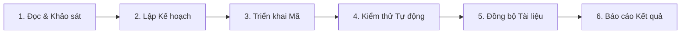

# AGENTS.md - Quy định & Hướng dẫn dành cho AI Agents (Financial_AI)

Tài liệu này xác định các nguyên tắc phát triển cốt lõi, kiến trúc hệ thống và quy trình làm việc chuẩn dành cho các AI Agent tham gia phát triển dự án **Financial_AI**.

---

## 1. Tổng quan Dự án

- **Tên dự án**: Financial_AI
- **Mục tiêu**: Hệ thống trích xuất dữ liệu từ Báo cáo tài chính (định dạng PDF scan hoặc text), chuẩn hóa chỉ tiêu tài chính và tính toán các tỷ số tài chính tự động kết hợp giao diện trực quan Streamlit.
- **Ngôn ngữ & Môi trường**: Python 3.13+, môi trường ảo `.venv`.

---

## 2. Cấu trúc Thư mục & Phân định Trách nhiệm

```text
Financial_AI/
├── app/
│   ├── main.py              # Giao diện người dùng Streamlit
│   ├── models/              # Schema & Pydantic models (FinancialItem, FinancialStatement)
│   ├── services/            # Logic xử lý nghiệp vụ (pdf_service, extraction_service, financial_service, ai_service)
│   └── utils/               # Tiện ích bổ trợ (export_utils, formatting)
├── data/
│   ├── uploads/             # File PDF tải lên tạm thời
│   └── processed/           # Dữ liệu trích xuất dạng trung gian
├── docs/                    # Tài liệu chuẩn hóa kỹ thuật và trạng thái dự án
├── exports/                 # Kết quả xuất khẩu (CSV, Excel)
├── reports/                 # Báo cáo phân tích đã tạo
├── tests/                   # Kiểm thử tự động (Unit tests, Integration tests)
├── .agents/                 # Workspace rules và agent skills
├── requirements.txt         # Khai báo thư viện phụ thuộc
└── AGENTS.md                # Tài liệu quy định dành cho Agent (file này)
```

---

## 3. Nguyên tắc Phát triển Cốt lõi (Core Principles)

### 3.1. Bảo mật và Quản lý Bí mật (Security & Secrets)
- **TUYỆT ĐỐI KHÔNG** đọc, in, hiển thị hoặc commit các giá trị khóa bí mật từ `.env` hoặc file secrets.
- Mọi biến môi trường mới phải được khai báo mẫu (không chứa giá trị thực) trong `.env.example`.

### 3.2. Tính Trung thực của Thông tin (Zero Hallucination)
- Không suy diễn hoặc bịa đặt tính năng chưa tồn tại.
- Phân định rõ ràng trạng thái tính năng theo 3 cấp độ:
  - **Đã triển khai (Implemented)**: Đã có mã nguồn hoạt động và có test kiểm chứng.
  - **Đang triển khai (In-Progress)**: Mã nguồn đang xây dựng dở dang hoặc chưa có test bao phủ.
  - **Kế hoạch (Planned)**: Mới nằm ở thiết kế hoặc tài liệu định hướng.
- Đối với các nội dung chưa kiểm chứng được trong môi trường hiện tại: Phải ghi nhận rõ trạng thái là **`Unknown`**, **`Pending`** hoặc **`Blocked`**.

### 3.3. Bảo toàn Logic Nghiệp vụ & Phạm vi (Scope Discipline)
- Không tự ý sửa đổi công thức tài chính hoặc quy tắc nghiệp vụ khi chưa có yêu cầu cụ thể.
- Không xóa file hoặc thay đổi danh mục thư viện trong `requirements.txt` trừ khi có chỉ đạo rõ ràng.
- Giữ nguyên các chú thích code hiện có.

### 3.4. Chuẩn mực Mã nguồn & Kiểu dữ liệu
- Tuân thủ PEP 8 và định dạng Python hiện đại (Python 3.10+ union types `float | None`).
- Sử dụng Pydantic v2 cho việc định nghĩa và validate dữ liệu thực thể.
- Xử lý triệt để các trường hợp ngoại lệ chia cho 0 (`ZeroDivisionError`) hoặc giá trị `None` trong các phép tính tỷ số tài chính.

---

## 4. Chuẩn Lệnh Chạy & Kiểm thử

Khi thực thi lệnh trên hệ thống Windows với Powershell:

| Tác vụ | Lệnh chuẩn | Ghi chú |
| :--- | :--- | :--- |
| **Chạy Test Suite** | `& .\.venv\Scripts\python -m pytest tests -v` | Phải chạy qua `python -m pytest tests` để nhận diện package `app` |
| **Khởi chạy Ứng dụng** | `& .\.venv\Scripts\streamlit run app/main.py` | Cổng mặc định 8501 |
| **Kiểm tra cú pháp** | `& .\.venv\Scripts\python -m py_compile app/main.py` | Kiểm tra compile trước khi chạy |

---

## 5. Quy trình Làm việc Chuẩn của Agent (6-Step Dev Cycle)

Mọi tác vụ can thiệp vào codebase cần tuân thủ quy trình 6 bước:



1. **Khảo sát (Inspection)**: Đọc file liên quan, kiểm tra test hiện tại, xác định dependency.
2. **Kế hoạch (Plan)**: Liệt kê các file sẽ tạo/sửa, phạm vi ảnh hưởng, trường hợp kiểm thử biên.
3. **Triển khai (Implementation)**: Viết code theo đúng scope, sử dụng type hint, không sửa logic ngoài yêu cầu.
4. **Kiểm thử (Verification)**: Chạy pytest đảm bảo 100% test case trong `tests/` pass.
5. **Cập nhật Docs (Documentation)**: Cập nhật `docs/PROJECT_STATUS.md` hoặc `docs/CHANGELOG.md` tương ứng.
6. **Báo cáo (Report)**: Tóm tắt file thay đổi, kết quả test và các việc tồn đọng (nếu có).
