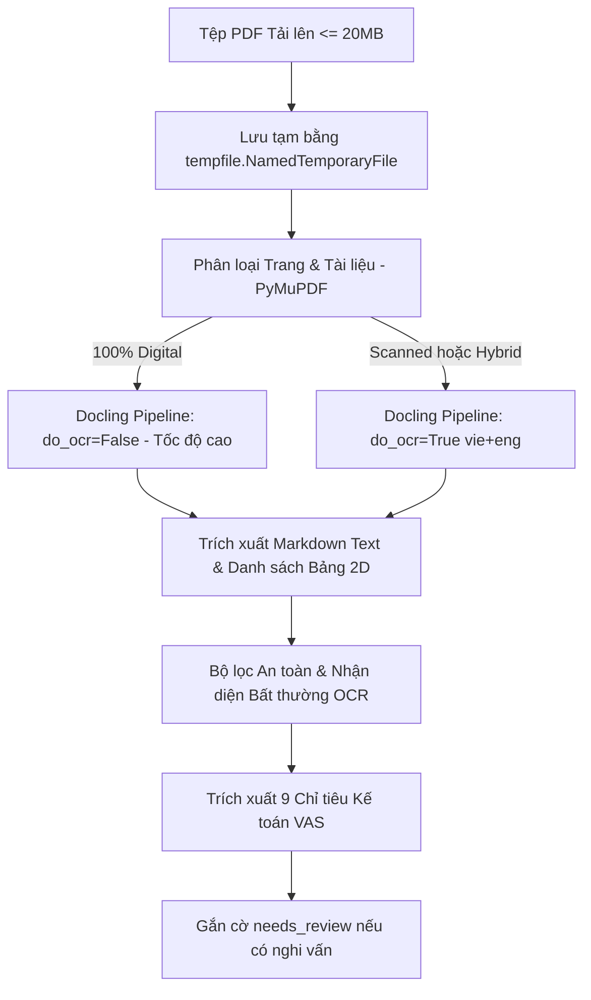
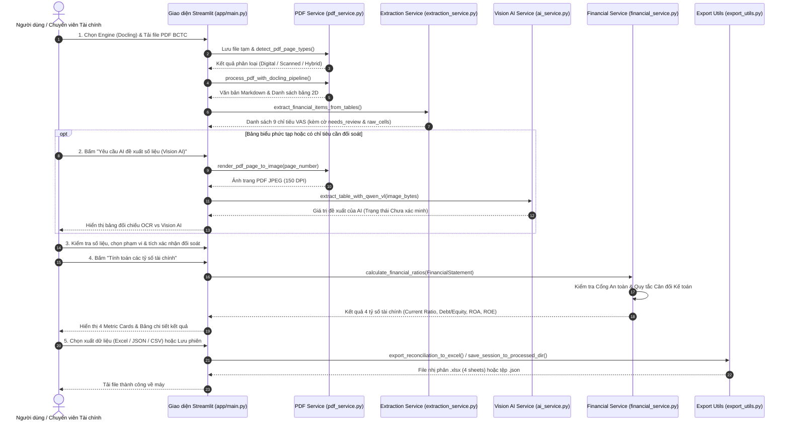

# Financial_AI 📊

**Financial_AI** là hệ thống trợ lý phân tích Báo cáo tài chính (BCTC) thông minh, tự động hóa quy trình bóc tách dữ liệu từ tệp PDF (cả văn bản số số hóa và bản scan ảnh), chuẩn hóa chỉ tiêu theo Hệ thống Kế toán Việt Nam (VAS), hỗ trợ cơ chế đối chiếu nguồn gốc minh bạch (Human-in-the-loop & Vision AI) và tính toán các tỷ số tài chính cốt lõi với giao diện tương tác Streamlit.

---

## 📑 Mục Lục
1. [Tổng quan Dự án](#1-tổng-quan-dự-án)
2. [Công nghệ Sử dụng & Tác dụng Chi tiết](#2-công-nghệ-sử-dụng--tác-dụng-chi-tiết)
3. [Cơ chế Xử lý Tệp PDF Upload](#3-cơ-chế-xử-lý-tệp-pdf-upload)
4. [Luồng Hoạt động Toàn hệ thống (Workflow)](#4-luồng-hoạt-động-toàn-hệ-thống-workflow)
5. [Các Bước Thực hiện & Hướng dẫn Thao tác](#5-các-bước-thực-hiện--hướng-dẫn-thao-tác)
6. [Hướng dẫn Cài đặt & Khởi chạy Dự án](#6-hướng-dẫn-cài-đặt--khởi-chạy-dự-án)
7. [Cấu trúc Thư mục & Tài liệu Kỹ thuật](#7-cấu-trúc-thư-mục--tài-liệu-kỹ-thuật)

---

## 1. Tổng quan Dự án

Báo cáo tài chính của các doanh nghiệp Việt Nam thường được công bố dưới dạng tệp PDF với nhiều định dạng phức tạp: văn bản số, bản scan chụp nghiêng, dấu mộc đỏ, vết nhòe hạt mực, hoặc bảng biểu có tiêu đề gộp nhiều tầng. Việc nhập liệu và tính toán thủ công tiềm ẩn rủi ro sai sót lớn và tốn nhiều nhân lực.

**Financial_AI** được xây dựng nhằm giải quyết bài toán này với 3 nguyên tắc cốt lõi:
- **Zero Hallucination (Không suy đoán bịa đặt)**: Hệ thống không tự động điền hoặc bịa số liệu khi chưa đủ bằng chứng. Mọi số liệu nghi vấn do scan mờ hoặc dính cột đều được gắn cờ cảnh báo `needs_review`.
- **Human-in-the-loop (Con người phê duyệt)**: AI và OCR đóng vai trò trợ lý đề xuất; người dùng giữ quyền quyết định cuối cùng thông qua quy trình đối soát trực quan từng chỉ tiêu trước khi bấm tính toán.
- **Data Provenance & Traceability (Minh bạch nguồn gốc)**: Bảo toàn nguyên vẹn chuỗi OCR gốc (`raw_cells`), trang PDF nguồn, dòng văn bản gốc và giá trị đề xuất của Vision AI để phục vụ kiểm toán và tra soát lại.

---

## 2. Công nghệ Sử dụng & Tác dụng Chi tiết

Hệ thống được thiết kế theo kiến trúc phân tầng hiện đại, kết hợp các thư viện xử lý tài liệu chuyên sâu, mô hình thị giác AI và chuẩn dữ liệu kế toán:

| STT | Công nghệ / Thư viện | Phiên bản | Tác dụng & Vai trò trong Hệ thống |
| :---: | :--- | :---: | :--- |
| **1** | **Python** | `3.13+` | Ngôn ngữ phát triển cốt lõi, tận dụng kiểu dữ liệu hiện đại (Modern Typing, Union `float \| None`). |
| **2** | **Streamlit** | `Latest` | Xây dựng giao diện Web tương tác tốc độ cao, hỗ trợ chia layout đa cột, widget nhập liệu, metric cards và quản lý trạng thái phiên làm việc (`st.session_state`). |
| **3** | **Docling** | `v2.14+` | Bộ công cụ AI phân tích bố cục tài liệu (Document Layout Analysis) của IBM. Tác dụng: Nhận diện chính xác cấu trúc bảng 2D, phân tách đa tầng cột năm, xử lý tiêu đề gộp dòng/cột và loại bỏ cột mã số/thuyết minh không làm lệch cột số liệu. |
| **4** | **PyMuPDF (fitz)** | `Latest` | Thư viện thao tác PDF hiệu năng cao bậc nhất bằng C++. Tác dụng: Quét phân loại từng trang PDF siêu tốc (đếm ký tự, khối văn bản, tỷ lệ diện tích ảnh) và kết xuất (render) trang PDF thành ảnh RGB/JPEG độ nét cao (150-200 DPI). |
| **5** | **Tesseract OCR & pytesseract** | `Latest` | Động cơ nhận diện ký tự quang học (OCR) mã nguồn mở. Tác dụng: Bóc tách lớp chữ từ các trang PDF scan ảnh với gói ngôn ngữ tiếng Việt (`vie`) và tiếng Anh (`eng`). |
| **6** | **OpenRouter & Qwen2.5-VL** | `API` | Mô hình Thị giác - Ngôn ngữ lớn (Vision AI 7B). Tác dụng: Đọc trực tiếp hình ảnh trang bảng biểu khó hoặc bị nhòe hạt mực, đưa ra giá trị đề xuất tham khảo độc lập giúp người dùng đối chiếu chéo với OCR. |
| **7** | **Pydantic v2** | `v2.x` | Định nghĩa Domain Models (`FinancialItem`, `FinancialStatement`, `ReconciliationSession`), xác thực dữ liệu chặt chẽ (strict validation), phát hiện lỗi logic và kiểm tra mất cân đối BCTC. |
| **8** | **Pandas** | `Latest` | Xử lý và thao tác dữ liệu dạng bảng (DataFrame), chuẩn hóa tiêu đề cột chống trùng lặp (`sanitize_dataframe_columns`), hỗ trợ hiển thị bảng dữ liệu trên UI. |
| **9** | **NumPy** | `Latest` | Thư viện toán học và mảng đa chiều, hỗ trợ tính toán số học nền tảng cho các dịch vụ tài chính. |
| **10** | **OpenPyXL** | `Latest` | Tạo và định dạng sổ tính Excel (.xlsx) chuyên nghiệp gồm 4 bảng tính (sheets) riêng biệt phục vụ lưu trữ và nộp báo cáo. |
| **11** | **pdfplumber** | `Latest` | Bóc tách văn bản số và lưới bảng vector truyền thống, đóng vai trò công cụ trích xuất tốc độ cao dự phòng (fallback engine). |
| **12** | **Pytest** | `Latest` | Khung kiểm thử tự động toàn diện với 92 test cases bao phủ toàn bộ pipeline từ bóc tách, chuẩn hóa, tính tỷ số đến xuất file. |
| **13** | **python-dotenv** | `Latest` | Tải và quản lý an toàn biến môi trường từ file `.env` (đường dẫn Tesseract, API keys), ngăn chặn rò rỉ khóa bí mật. |

---

## 3. Cơ chế Xử lý Tệp PDF Upload

Quy trình xử lý tệp PDF khi người dùng tải lên được thực hiện tự động qua 5 lớp xử lý an toàn:



### 3.1. Phân loại Tài liệu Đa tầng (Document Classification)
Module `detect_pdf_page_types` trong [app/services/pdf_service.py](file:///c:/Users/admin/Desktop/A_Ky1_Nam4/Cong_nghe_tai_chinh/Financial_AI/app/services/pdf_service.py) phân tích từng trang dựa trên:
- Số lượng ký tự (`char_count`) và khối văn bản (`text_blocks_count`).
- Số lượng hình ảnh và tỷ lệ diện tích ảnh lớn nhất trên trang (`max_image_area_ratio`).
- **Phân loại trang**:
  - `digital`: Trang văn bản số rõ ràng (>= 100 ký tự, >= 2 khối văn bản, không có ảnh scan lớn).
  - `scanned`: Trang thuần ảnh scan hoặc lớp chữ < 30 ký tự và có ảnh lớn che phủ (>= 25% diện tích).
  - `uncertain`: Trang hỗn hợp (văn bản ít, có hình ảnh hoặc bảng quét chèn vào).
- **Cấp độ tài liệu**: `digital` (100% trang digital), `scanned` (100% trang scan), `hybrid` (trang số xen kẽ trang scan), `uncertain` (cần kiểm tra thêm).

### 3.2. Cơ chế Xử lý Single-Pass Tối ưu
Thay vì chạy trích xuất văn bản và bảng biểu qua hai lượt riêng biệt gây tốn gấp đôi thời gian, hàm `process_pdf_with_docling_pipeline`:
- Chạy Docling qua một lượt chuyển đổi duy nhất (`Single-Pass`).
- **Tự động thích ứng**: Nếu tài liệu là `digital` thuần túy, tự động tắt OCR (`do_ocr=False`) để xử lý tức thì chỉ trong vài giây. Nếu phát hiện trang `scanned` hoặc `hybrid`, tự động bật `TesseractCliOcrOptions` với ngôn ngữ `vie+eng`.

### 3.3. Bộ lọc Khử nhiễu & Phát hiện Bất thường OCR
Module [app/services/extraction_service.py](file:///c:/Users/admin/Desktop/A_Ky1_Nam4/Cong_nghe_tai_chinh/Financial_AI/app/services/extraction_service.py) áp dụng các thuật toán phòng vệ:
- **Chuẩn hóa Tiếng Việt (Unicode NFD)**: Loại bỏ dấu thanh, chuyển đổi ký tự `đ/Đ` thành `d`, chuyển chữ thường để khớp chính xác các từ khóa kế toán VAS.
- **Phát hiện dính cột (Concatenated Columns)**: Nhận diện chuỗi số bất thường (> 16 chữ số) hoặc ô chứa nhiều số cách nhau bằng khoảng trắng.
- **Xử lý số âm**: Nhận diện linh hoạt số âm đặt trong dấu ngoặc đơn `(100.000)` hoặc ngoặc vuông `[100.000]`.
- **Khử hạt mực scan**: Hiệu chỉnh các lỗi OCR phổ biến như nhòe dấu chấm phân cách hàng nghìn thành dấu phẩy.
- **Cổng cảnh báo**: Tự động đánh dấu `status="needs_review"` và lưu lại chuỗi gốc `raw_cells` khi có bất kỳ dấu hiệu nghi vấn nào.

---

## 4. Luồng Hoạt động Toàn hệ thống (Workflow)

Biểu đồ tuần tự dưới đây mô tả chi tiết tương tác giữa Người dùng, Giao diện UI, Các Service nghiệp vụ, Vision AI và Tầng lưu trữ:



---

## 5. Các Bước Thực hiện & Hướng dẫn Thao tác

Khi làm việc trên giao diện ứng dụng, người dùng thực hiện tuần tự qua các bước:

### Bước 1: Thiết lập & Tải tài liệu
1. **Chọn bộ công cụ tại thanh bên (Sidebar)**:
   - `Docling (Khuyên dùng)`: Nhận diện bảng thông minh, bảo toàn cấu trúc cột năm.
   - `pdfplumber`: Phù hợp cho việc đọc nhanh văn bản đơn giản.
2. *(Tùy chọn)* Nạp lại phiên đối soát cũ bằng cách tải tệp `.json` tại mục **"Quản lý Phiên đối soát"** để tiếp tục công việc trước đó mà không mất lịch sử xác minh.
3. Tải tệp Báo cáo tài chính định dạng PDF (dung lượng tối đa 20 MB).
4. Xem bảng thông tin phân loại tài liệu (Số trang Digital, Scan, Uncertain và hành động đề xuất).

### Bước 2: Xem văn bản trích xuất
- Mở rộng mục **"2. Toàn bộ văn bản trích xuất"** để xem toàn bộ nội dung văn bản bóc tách từ tài liệu.
- Bấm nút **"Tải nội dung văn bản (.txt)"** nếu cần lưu trữ văn bản thô.

### Bước 3: Kiểm tra bảng biểu & Đối chiếu Vision AI
- Xem danh sách các bảng số liệu được hệ thống phát hiện theo từng trang.
- Đối với các bảng quan trọng hoặc bị nghi ngờ mờ nhòe: Bấm nút **"🔍 Yêu cầu AI đề xuất số liệu (Vision AI)"**.
- Hệ thống sẽ hiển thị ảnh cắt từ trang PDF gốc song song với bảng gợi ý của mô hình Qwen2.5-VL để người dùng đối chiếu.

### Bước 4: Kiểm tra kết quả nhận diện chỉ tiêu tài chính
- Bảng tổng hợp hiển thị 9 chỉ tiêu cốt lõi:
  1. *Tài sản ngắn hạn* (`CURRENT_ASSETS` - Mã 100)
  2. *Nợ ngắn hạn* (`CURRENT_LIABILITIES` - Mã 310)
  3. *Tổng nợ phải trả* (`TOTAL_LIABILITIES` - Mã 300)
  4. *Vốn chủ sở hữu* (`TOTAL_EQUITY` - Mã 400)
  5. *Tổng tài sản* (`TOTAL_ASSETS` - Mã 270)
  6. *Lợi nhuận sau thuế* (`NET_INCOME` - Mã 60)
  7. *Doanh thu thuần* (`REVENUE` - Mã 10)
  8. *Giá vốn hàng bán* (`COGS` - Mã 11)
  9. *Lợi nhuận gộp* (`GROSS_PROFIT` - Mã 20)
- Kiểm tra cột **"Đối chiếu trích xuất và AI"**:
  - `✅ Trùng khớp`: Số liệu OCR và Vision AI nhất quán.
  - `⚠️ Có sự chênh lệch`: Xuất hiện sai lệch số liệu, cần kiểm tra kỹ bản gốc.
  - `⚠️ Cần đối soát`: Số liệu bị nghi vấn định dạng hoặc dính cột.

### Bước 5: Kiểm tra và đối soát số liệu trên Form
1. Nhập hoặc xác nhận **Năm tài chính kỳ hiện tại** (bắt buộc, không để trống).
2. Chọn **Phạm vi báo cáo**: `Báo cáo hợp nhất` hoặc `Báo cáo riêng` (tuyệt đối không trộn lẫn số liệu giữa hai phạm vi).
3. Xác nhận **Đơn vị tính** (ví dụ: `VND` hoặc `TRIEU_VND`).
4. Điều chỉnh các ô số liệu kỳ này (cuối kỳ) và kỳ trước (đầu kỳ) cho chuẩn xác với báo cáo gốc.
5. Tích chọn các ô xác nhận đối soát:
   - Tích xác nhận riêng cho từng chỉ tiêu có cờ cảnh báo `needs_review`.
   - Tích chọn ô cam kết: *"Tôi đã đối soát toàn diện và xác nhận tính chính xác của các số liệu trên với báo cáo tài chính gốc"*.
6. Bấm **"Tính toán các tỷ số tài chính"**.

### Bước 6: Đọc kết quả phân tích tỷ số tài chính
Hệ thống hiển thị kết quả qua 4 Metric Cards và bảng giải nghĩa:
- **Hệ số thanh toán hiện hành (Current Ratio)**: $\frac{\text{Tài sản ngắn hạn}}{\text{Nợ ngắn hạn}}$
- **Tỷ số nợ trên vốn CSH (Debt/Equity)**: $\frac{\text{Tổng nợ phải trả}}{\text{Vốn chủ sở hữu}}$
- **Tỷ suất sinh lời trên tổng tài sản (ROA %)**: $\frac{\text{Lợi nhuận sau thuế}}{\text{Tổng tài sản bình quân}} \times 100$
- **Tỷ suất sinh lời trên vốn CSH (ROE %)**: $\frac{\text{Lợi nhuận sau thuế}}{\text{Vốn chủ sở hữu bình quân}} \times 100$

> [!NOTE]
> Hệ thống áp dụng cơ chế chia phòng vệ (`_safe_divide`). Nếu mẫu số bằng 0 hoặc thiếu dữ liệu đầu kỳ để tính số bình quân, hệ thống hiển thị *"Chưa thể tính"* thay vì gây sập ứng dụng (`ZeroDivisionError`).

### Bước 7: Xuất báo cáo & Lưu phiên đối soát
- 📊 **Tải sổ tính Excel (.xlsx)**: Xuất file Excel chuẩn gồm 4 sheets:
  1. *Financial_Data*: Các chỉ tiêu tài chính chính thức.
  2. *Reconciliation*: Lịch sử đối soát, mã VAS, chuỗi OCR gốc, gợi ý AI và trạng thái xác minh.
  3. *Financial_Ratios*: Các tỷ số tài chính đã tính kèm công thức và giải nghĩa.
  4. *Session_Metadata*: Thông tin tệp gốc, mã băm SHA-256, thời gian và công cụ xử lý.
- 📑 **Tải dữ liệu phiên (.json)**: Xuất file JSON chứa toàn bộ dữ liệu cấu trúc Pydantic để nạp lại sau này.
- 💾 **Lưu phiên vào hệ thống**: Lưu tệp JSON an toàn (Atomic Write) vào thư mục `data/processed/`.
- 📄 **Tải kết quả CSV (.csv)**: Tải nhanh bảng kết quả tỷ số định dạng CSV mã hóa `UTF-8 with BOM`.

---

## 6. Hướng dẫn Cài đặt & Khởi chạy Dự án

### 6.1. Yêu cầu Hệ thống
- **Hệ điều hành**: Windows 10/11, macOS hoặc Linux.
- **Python**: Phiên bản 3.10 trở lên (khuyên dùng Python 3.13).
- **Tesseract OCR** *(bắt buộc để xử lý file scan)*:
  - Tải bộ cài Windows tại: [UB-Mannheim Tesseract OCR](https://github.com/UB-Mannheim/tesseract/wiki).
  - Cài đặt vào đường dẫn mặc định: `C:\Program Files\Tesseract-OCR\tesseract.exe`.
  - Trong quá trình cài đặt, tích chọn gói ngôn ngữ **Vietnamese (`vie`)** và **English (`eng`)**.

### 6.2. Thiết lập Môi trường Ảo & Cài đặt Thư viện
Mở PowerShell tại thư mục gốc dự án:

```powershell
# 1. Khởi tạo môi trường ảo Python
python -m venv .venv

# 2. Kích hoạt môi trường ảo
# Trên Windows PowerShell:
.\.venv\Scripts\Activate.ps1
# Trên Windows CMD:
.\.venv\Scripts\activate.bat
# Trên Linux/macOS:
source .venv/bin/activate

# 3. Cập nhật pip và cài đặt thư viện phụ thuộc
python -m pip install --upgrade pip
pip install -r requirements.txt
```

### 6.3. Cấu hình Biến Môi trường (`.env`)
Tạo file `.env` từ file mẫu [.env.example](file:///.env.example):

```powershell
cp .env.example .env
```

Nội dung cấu hình trong `.env`:
```env
# Đường dẫn tệp thực thi Tesseract OCR (nếu khác đường dẫn mặc định)
TESSERACT_CMD=C:\Program Files\Tesseract-OCR\tesseract.exe

# Cấu hình OpenRouter API phục vụ Vision AI (Tùy chọn)
OPENROUTER_API_KEY=your_openrouter_api_key_here
```

> [!CAUTION]
> **Tuyệt đối không** commit tệp `.env` hoặc để lộ API key lên kho lưu trữ Git. Tệp `.env` đã được chặn hoàn toàn trong [.gitignore](file:///.gitignore).

### 6.4. Khởi chạy Ứng dụng
Chạy ứng dụng Streamlit bằng lệnh:

```powershell
& .\.venv\Scripts\streamlit run app/main.py
```

Truy cập giao diện tại địa chỉ:  
👉 **http://localhost:8501**

### 6.5. Chạy Kiểm thử Tự động (Testing)
Dự án được bảo vệ bằng hệ thống unit & integration test toàn diện (92 test cases):

```powershell
& .\.venv\Scripts\python -m pytest tests -v
```

Kiểm tra cú pháp code mà không khởi chạy ứng dụng:
```powershell
& .\.venv\Scripts\python -m py_compile app/main.py
```

---

## 7. Cấu trúc Thư mục & Tài liệu Kỹ thuật

### 7.1. Cấu trúc Cây Thư mục
```text
Financial_AI/
├── app/
│   ├── main.py                     # [Presentation] Giao diện người dùng Streamlit & điều phối luồng
│   ├── models/                     # [Domain Models] Schema Pydantic v2
│   │   ├── __init__.py
│   │   └── financial_statement.py  # FinancialItem, FinancialStatement, ReconciliationSession
│   ├── services/                   # [Business Logic] Các dịch vụ xử lý lõi
│   │   ├── __init__.py
│   │   ├── pdf_service.py          # Phân loại tài liệu, Docling pipeline, OCR Tesseract, Render ảnh
│   │   ├── extraction_service.py   # Chuẩn hóa NFD tiếng Việt, lọc số OCR, bóc tách chỉ tiêu VAS
│   │   ├── financial_service.py    # Tính tỷ số an toàn, phòng vệ chia cho 0, cổng xác thực
│   │   └── ai_service.py           # Kết nối Vision AI Qwen2.5-VL qua OpenRouter
│   └── utils/                      # [Utilities] Tiện ích dùng chung
│       ├── __init__.py
│       ├── dataframe_utils.py      # Làm sạch tên cột DataFrame, chống duplicate headers
│       └── export_utils.py         # Xuất Excel 4 sheets, JSON roundtrip, lưu phiên an toàn
├── data/                           # [Data Layer] Quản lý dữ liệu tệp (được ignore trên git)
│   ├── uploads/                    # Lưu file PDF tạm trong quá trình tải
│   └── processed/                  # Lưu trữ phiên đối soát JSON
├── docs/                           # Tài liệu kỹ thuật chi tiết
│   ├── ARCHITECTURE.md             # Kiến trúc phân lớp và luồng dữ liệu
│   ├── REQUIREMENTS.md             # Đặc tả yêu cầu chức năng và phi chức năng
│   ├── DATA_DICTIONARY.md          # Từ điển chỉ tiêu VAS và công thức tỷ số
│   ├── TESTING.md                  # Hướng dẫn và kịch bản kiểm thử tự động
│   ├── DECISIONS.md                # Nhật ký quyết định kiến trúc (ADR)
│   ├── PROJECT_STATUS.md           # Hiện trạng tính năng và lộ trình phát triển
│   └── CHANGELOG.md                # Lịch sử phiên bản
├── exports/                        # Thư mục xuất file kết quả
├── reports/                        # Thư mục chứa báo cáo phân tích
├── tests/                          # 92 unit tests tự động
├── AGENTS.md                       # Quy chuẩn phát triển dành cho AI Agents
├── requirements.txt                # Danh mục thư viện phụ thuộc
└── README.md                       # Tài liệu hướng dẫn dự án (tệp này)
```

### 7.2. Danh mục Tài liệu Chuyên sâu
Để tìm hiểu sâu hơn về kiến trúc và các quy chuẩn kế toán:
- [AGENTS.md](file:///c:/Users/admin/Desktop/A_Ky1_Nam4/Cong_nghe_tai_chinh/Financial_AI/AGENTS.md): Quy định phát triển và quy trình 6 bước dành cho AI Agent.
- [docs/ARCHITECTURE.md](file:///c:/Users/admin/Desktop/A_Ky1_Nam4/Cong_nghe_tai_chinh/Financial_AI/docs/ARCHITECTURE.md): Phân tích chi tiết kiến trúc phân lớp và tương tác các module.
- [docs/DATA_DICTIONARY.md](file:///c:/Users/admin/Desktop/A_Ky1_Nam4/Cong_nghe_tai_chinh/Financial_AI/docs/DATA_DICTIONARY.md): Chi tiết 9 chỉ tiêu theo VAS và công thức tính toán 4 tỷ số tài chính.
- [docs/TESTING.md](file:///c:/Users/admin/Desktop/A_Ky1_Nam4/Cong_nghe_tai_chinh/Financial_AI/docs/TESTING.md): Kịch bản kiểm thử tự động và danh mục 92 unit test cases.
- [docs/PROJECT_STATUS.md](file:///c:/Users/admin/Desktop/A_Ky1_Nam4/Cong_nghe_tai_chinh/Financial_AI/docs/PROJECT_STATUS.md): Bảng ma trận theo dõi tiến độ và hiện trạng tính năng.
