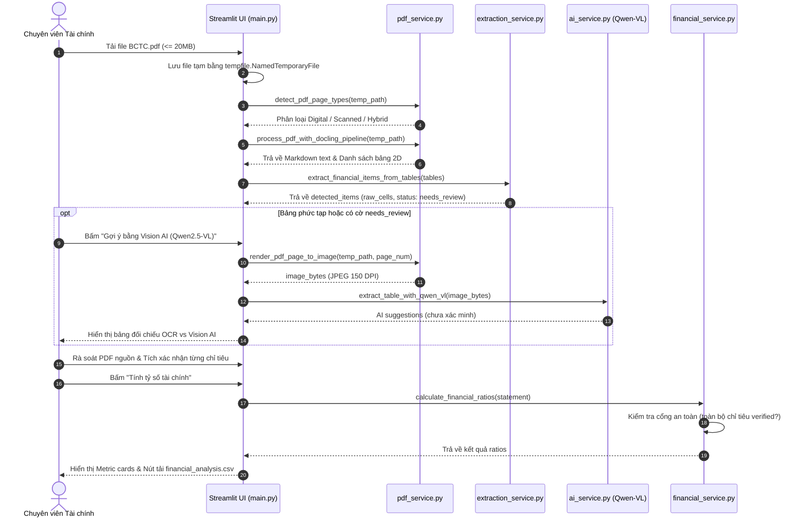

# Kiến trúc Hệ thống (System Architecture) - Financial_AI

> **Tài liệu**: Thiết kế Kiến trúc & Phân rã Module  
> **Phiên bản**: 1.0.0  
> **Áp dụng cho**: Core System & Luồng dữ liệu End-to-End

---

## 1. Cấu trúc Tổng thể & Phân rã Trách nhiệm

Hệ thống Financial_AI được tổ chức theo kiến trúc phân lớp (Layered Architecture), tách biệt giữa tầng hiển thị (Presentation Layer), tầng logic nghiệp vụ (Service Layer) và tầng mô hình dữ liệu (Domain Model Layer).

```text
Financial_AI/
├── app/
│   ├── main.py                     # [Presentation] Giao diện người dùng Streamlit & điều phối luồng
│   ├── models/                     # [Domain Models] Định nghĩa cấu trúc thực thể & xác thực dữ liệu
│   │   ├── __init__.py
│   │   └── financial_statement.py  # Model Pydantic FinancialItem & FinancialStatement
│   ├── services/                   # [Business Logic] Các dịch vụ xử lý nghiệp vụ độc lập
│   │   ├── __init__.py
│   │   ├── pdf_service.py          # Bóc tách văn bản, bảng, xử lý OCR và render ảnh từ tệp PDF
│   │   ├── extraction_service.py   # Nhận diện chỉ tiêu tài chính bằng luật Regex & Chuẩn hóa văn bản
│   │   ├── financial_service.py    # Tính toán các tỷ số tài chính và xử lý chia an toàn
│   │   └── ai_service.py           # [Implemented] Tích hợp Vision AI Qwen2.5-VL qua OpenRouter đối chiếu OCR
│   └── utils/                      # [Utilities] Tiện ích bổ trợ dùng chung
│       ├── __init__.py
│       ├── dataframe_utils.py       # [Implemented] Chuẩn hóa tên cột DataFrame, xử lý cột rỗng và chống trùng cột
│       └── export_utils.py         # [Implemented] Xuất Excel 4 sheet (.xlsx), JSON roundtrip và lưu phiên đối soát
├── data/                           # [Data Layer] Quản lý dữ liệu tệp (được loại trừ khỏi git)
│   ├── uploads/                    # Tệp PDF tạm thời
│   └── processed/                  # Lưu trữ phiên đối soát JSON an toàn (Atomic Write)
├── docs/                           # Tài liệu kỹ thuật dự án
├── exports/                        # Tệp kết quả phân tích xuất ra (CSV, Excel)
├── reports/                        # Tệp báo cáo tổng hợp
├── tests/                          # [Testing] Kiểm thử tự động (Unit & Integration tests)
│   ├── test_extraction_service.py  # Kiểm thử logic bóc tách chỉ tiêu
│   └── test_financial_service.py   # Kiểm thử logic tính tỷ số tài chính
├── AGENTS.md                       # Nguyên tắc phát triển dành cho AI Agents
├── requirements.txt                # Danh mục thư viện phụ thuộc
└── test_docling.py                 # [Scratch Prototype] Thử nghiệm độc lập thư viện Docling
```

---

## 2. Vai trò Chi tiết của Từng Module

### 2.1. Tầng Trình diễn (Presentation Layer)
- **`app/main.py`**:
  - Khởi tạo cấu hình trang Streamlit (`page_title="Financial AI"`, `layout="wide"`).
  - Tiếp nhận tệp PDF qua `st.file_uploader`, giới hạn kích thước tối đa 20 MB.
  - Sử dụng hàm đệm cache `@st.cache_data` với hàm `process_pdf` để tránh việc phải đọc lại tệp khi giao diện tương tác.
  - Cung cấp form xác thực số liệu hai cột (Số liệu kỳ hiện tại và số liệu đầu kỳ/cuối kỳ) cho người dùng rà soát trước khi tính toán.
  - Hiển thị kết quả qua Metric cards và cho phép tải về dưới dạng `.csv` có mã hóa `utf-8-sig`.

### 2.2. Tầng Mô hình Thực thể (Domain Models Layer)
- **`app/models/financial_statement.py`**:
  - `FinancialItem`: Đại diện cho một dòng chỉ tiêu tài chính gồm `code` (chuỗi định danh), `name` (tên chỉ tiêu), `value` (giá trị số thực) và `unit` (mặc định VND). Tự động chuẩn hóa cắt khoảng trắng thừa qua `str_strip_whitespace=True`.
  - `FinancialStatement`: Đại diện cho một báo cáo tài chính hoàn chỉnh gồm `company_name`, `report_type` (chỉ chấp nhận `balance_sheet`, `income_statement`, hoặc `cash_flow`), `fiscal_year` (nằm trong khoảng 1900-2100), `period_end`, `currency` và danh sách các `items`.

### 2.3. Tầng Dịch vụ Nghiệp vụ (Service Layer)
- **`app/services/pdf_service.py`**:
  - `_validate_pdf`: Kiểm tra sự tồn tại của tệp, đảm bảo là tệp tin hợp lệ và có đuôi mở rộng `.pdf`.
  - `extract_text_from_pdf`: Trích xuất text từng trang thông qua `pdfplumber`. Nếu độ dài text < 50 ký tự (tài liệu scan), tự động chuyển sang cơ chế OCR Tesseract `vie+eng`.
  - `_extract_text_with_ocr`: Render từng trang PDF sang ảnh RGB 200 DPI bằng `pymupdf` (tự động xử lý xoay trang `Rotate 90/270`) và trích xuất chữ bằng `pytesseract` với gói ngôn ngữ tiếng Việt + tiếng Anh (`vie+eng`).
  - `extract_tables_from_pdf`: Trích xuất danh sách bảng từ PDF qua `pdfplumber.extract_tables()` (chỉ dùng cho PDF có lớp văn bản số).
  - `get_docling_converter`: Khởi tạo Docling `DocumentConverter` với `TesseractCliOcrOptions` (`tesseract_cmd=C:\Program Files\Tesseract-OCR\tesseract.exe`, `lang=['vie', 'eng']`) và bổ sung PATH tiến trình an toàn.
  - `process_pdf_with_docling_pipeline`: Xử lý PDF theo cơ chế Single-Pass, trả về đồng thời văn bản Markdown và danh sách bảng biểu, loại bỏ hoàn toàn việc OCR lặp hai lần.
  - `extract_tables_with_docling`: Hàm tương thích ngược lấy danh sách bảng từ Docling.
  - `render_pdf_page_to_image`: Render trang PDF thành ảnh JPEG 150 DPI (tự động xử lý xoay trang và crop bounding box nếu có) phục vụ gửi Vision AI với kích thước tối ưu payload (< 1600px).
- **`app/services/extraction_service.py`**:
  - `_normalize_text`: Chuyển đổi Unicode dạng NFD, loại bỏ dấu tiếng Việt, thay thế ký tự `đ/Đ` thành `d`, chuyển về chữ thường để so khớp nhãn chuẩn.
  - `is_suspicious_ocr_number`: Bộ lọc an toàn phát hiện chuỗi số dính cột siêu dài (>16 chữ số), nhiều số cách nhau bằng khoảng trắng trong 1 ô, hoặc cụm phân cách hàng nghìn không chuẩn.
  - `_parse_number`: Phân tích chuỗi số phức tạp (hỗ trợ số âm trong ngoặc đơn `(100.000)`, ngoặc vuông `[100.000]`, hiệu chỉnh nhòe hạt mực dấu chấm thành phẩy trong chuỗi số nghìn).
  - `extract_financial_items_from_tables`: Quét bảng Docling 2D, tách riêng số liệu Hợp nhất vs Riêng lẻ, phát hiện bất thường OCR và tự động gắn cờ `status="needs_review"`, bảo toàn chuỗi gốc `raw_cells` cho người dùng đối chiếu.
  - `extract_financial_items`: Quét văn bản theo dòng cho luồng pdfplumber truyền thống.
- **`app/services/financial_service.py`**:
  - `_safe_divide`: Hàm chia phòng vệ, trả về `None` nếu một trong hai toán hạng là `None` hoặc mẫu số bằng 0.
  - `calculate_financial_ratios`: Nhận từ điển tham số và tính toán:
    - **Current Ratio**: $\frac{\text{Tài sản ngắn hạn}}{\text{Nợ ngắn hạn}}$
    - **Debt/Equity**: $\frac{\text{Tổng nợ phải trả}}{\text{Vốn chủ sở hữu}}$
    - **ROA (%)**: $\frac{\text{Lợi nhuận sau thuế}}{\text{Tổng tài sản bình quân}} \times 100$
    - **ROE (%)**: $\frac{\text{Lợi nhuận sau thuế}}{\text{Vốn chủ sở hữu bình quân}} \times 100$
  - Cổng an toàn: Từ chối tính tỷ số khi bất kỳ chỉ tiêu then chốt nào mang cờ `needs_review`, thiếu năm hoặc sai phạm vi.
- **`app/services/ai_service.py`** *([Implemented] - Giai đoạn 2)*:
  - Tích hợp mô hình Vision AI `qwen/qwen-2.5-vl-7b-instruct:free` qua cổng OpenRouter.
  - Hàm `extract_table_with_qwen_vl`: Bóc tách chỉ tiêu tài chính từ ảnh bảng báo cáo phức tạp hoặc bị nhiễu dấu scan.
  - Quy tắc an toàn: Không đoán số unreadable, không tự động verified, sanitize sạch API key, trả về trạng thái có cấu trúc (`success`, `not_configured`, `timeout`, `rate_limited`, v.v.).

---

## 3. Luồng Dữ liệu Chi tiết (End-to-End Data Flow)



---

## 4. Công nghệ và Thư viện Phụ thuộc

| Thư viện | Phiên bản yêu cầu | Mục đích sử dụng | Trạng thái tích hợp |
| :--- | :--- | :--- | :---: |
| **streamlit** | Mới nhất | Giao diện tương tác người dùng | `Implemented` |
| **pandas** | Mới nhất | Xử lý cấu trúc dữ liệu bảng và xuất CSV | `Implemented` |
| **numpy** | Mới nhất | Hỗ trợ tính toán mảng và số học | `Implemented` |
| **pdfplumber** | Mới nhất | Trích xuất ký tự và lưới bảng từ PDF vector | `Implemented` |
| **pydantic** | v2 | Định nghĩa Schema, Adapter và Cổng xác thực dữ liệu BCTC | `Implemented` |
| **pymupdf** | Mới nhất | Render ảnh trang PDF độ nét cao phục vụ OCR và Vision AI | `Implemented` |
| **pytesseract** | Mới nhất | Wrapper cho công cụ Tesseract OCR tiếng Việt | `In-Progress` |
| **pytest** | Mới nhất | Khung chạy unit test tự động (92 tests) | `Implemented` |
| **docling** | v2.141+ | Phân tích layout tài liệu 2D, trích xuất bảng chính xác | `Implemented` |
| **httpx** | Mới nhất | Client HTTP gọi OpenRouter API có timeout và bắt lỗi an toàn | `Implemented` |
| **pillow** | Mới nhất | Xử lý ảnh kích thước tối ưu payload Vision AI | `Implemented` |
| **openpyxl** | Mới nhất | Xử lý xuất workbook Excel đa sheet (.xlsx) | `Implemented` |
| **plotly** | Mới nhất | Vẽ biểu đồ trực quan hóa dữ liệu | `Planned` |
| **python-dotenv** | Mới nhất | Tải biến môi trường từ tệp cấu hình | `Planned` |

---

## 5. Phân định Trạng thái Triển khai Thành phần

1. **Thành phần đã vận hành thực tế (`Implemented`)**:
   - Khung trích xuất bảng 2D `docling` phân định cột năm và khử nhiễu mã số/thuyết minh.
   - Module phân loại PDF theo từng trang (Digital / Scanned / Uncertain / Hybrid).
   - Module `ai_service.py` kết nối Vision AI Qwen2.5-VL qua OpenRouter hỗ trợ đối chiếu OCR.
   - Hàm `render_pdf_page_to_image` trong `pdf_service.py` trích xuất ảnh JPEG tối ưu payload.
   - Module `export_utils.py` xuất Excel 4 sheet (.xlsx), JSON roundtrip và lưu phiên đối soát Atomic Write vào `data/processed/`.
   - Giao diện Streamlit tương tác đối chiếu trực quan OCR–AI, nạp/lưu phiên đối soát, cảnh báo bất thường, xác nhận thủ công từng chỉ tiêu.
   - Thuật toán Regex và bộ lọc số an toàn OCR bóc tách chỉ tiêu tài chính.
   - Mô hình Pydantic v2 (`FinancialItem`, `FinancialStatement`, `ReconciliationSession`), Adapter chuyển đổi `create_statements_from_extracted_items`, kiểm tra cân đối BCTC.
   - Hàm tính toán tỷ số tài chính an toàn chấp nhận `FinancialStatement`, từ chối tính khi chưa xác minh hoặc trộn lẫn phạm vi.
   - Module `dataframe_utils` chuẩn hóa cột DataFrame chống lỗi duplicate columns trong Streamlit.
   - Bộ 92 unit tests tự động bao phủ 100% các thành phần cốt lõi.
2. **Thành phần đang trong quá trình tích hợp (`In-Progress`)**:
   - Cơ chế OCR qua Tesseract: Mã nguồn đã có, tuy nhiên cần chuẩn hóa cấu hình đường dẫn động qua biến môi trường.
3. **Thành phần chỉ mới nằm trong định hướng (`Planned`)**:
   - Trực quan hóa biểu đồ xu hướng bằng `plotly`.
