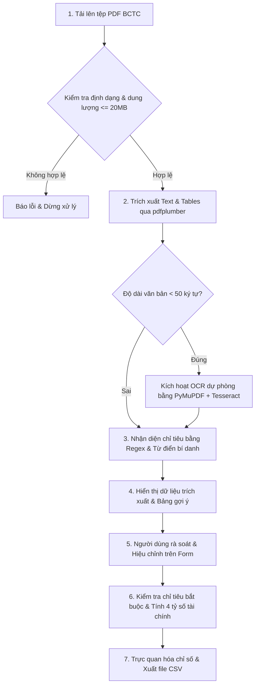

# Đặc tả Yêu cầu Kỹ thuật (Requirements Specification) - Financial_AI

> **Tài liệu**: Yêu cầu Hệ thống & Nghiệp vụ  
> **Phiên bản**: 1.0.0  
> **Áp dụng cho**: Core System & Streamlit Application

---

## 1. Mục tiêu và Đối tượng Sử dụng

### 1.1. Mục tiêu Hệ thống
- Tự động hóa quá trình thu thập, trích xuất dữ liệu từ các tệp Báo cáo tài chính (BCTC) định dạng PDF của doanh nghiệp Việt Nam.
- Chuẩn hóa các chỉ tiêu kế toán, giảm thiểu sai sót do nhập liệu thủ công.
- Hỗ trợ tính toán nhanh các chỉ số tài chính căn bản phục vụ công tác thẩm định tín dụng, phân tích đầu tư hoặc nghiên cứu học thuật.
- Cung cấp giao diện trực quan cho phép chuyên viên xem lại dữ liệu gốc, điều chỉnh khi cần thiết và tải báo cáo kết quả.

### 1.2. Đối tượng Sử dụng
- **Chuyên viên phân tích tài chính / Tín dụng ngân hàng**: Cần bóc tách nhanh số liệu từ BCTC của khách hàng doanh nghiệp.
- **Nhà đầu tư cá nhân**: Cần trích xuất nhanh số liệu BCTC công bố định kỳ của các công ty niêm yết.
- **Giảng viên và sinh viên khối ngành Kinh tế / Tài chính**: Thực hành phân tích định lượng dựa trên số liệu thực tế.

---

## 2. Đầu vào & Đầu ra Hệ thống

### 2.1. Dữ liệu Đầu vào (Inputs)
- **Định dạng**: Tệp PDF (`.pdf`), hỗ trợ:
  - PDF văn bản số (Digital PDF) được xuất từ phần mềm kế toán hoặc bản in điện tử.
  - PDF dạng ảnh chụp/quét (Scanned PDF) có văn bản tiếng Việt/Anh.
- **Giới hạn kỹ thuật**: Dung lượng tệp tối đa không vượt quá **20 MB**.
- **Dữ liệu hiệu chỉnh**: Người dùng có thể trực tiếp bổ sung hoặc chỉnh sửa số liệu trên Form giao diện nếu việc trích xuất tự động bị thiếu hoặc sai lệch.

### 2.2. Dữ liệu Đầu ra (Outputs)
- **Văn bản thô đã trích xuất**: Hiển thị trên màn hình và cho phép tải về dưới dạng `.txt` (`financial_statement.txt`).
- **Các bảng biểu phát hiện được**: Hiển thị dưới dạng DataFrame trên giao diện.
- **Bảng chỉ tiêu tài chính nhận diện**: Mã chỉ tiêu, giá trị kỳ hiện tại, giá trị kỳ trước và dòng văn bản nguồn.
- **Bộ 4 chỉ số tài chính tính toán**: Hiển thị trực quan qua metric cards và bảng dữ liệu tóm tắt.
- **Tệp báo cáo xuất khẩu**: Tệp CSV (`financial_analysis.csv`) mã hóa `utf-8-sig` (tương thích hoàn toàn với Microsoft Excel tiếng Việt).

---

## 3. Quy trình Nghiệp vụ (Business Process Flow)

---

## 4. Yêu cầu Chức năng (Functional Requirements)

| Mã | Tên chức năng | Mô tả chi tiết | Trạng thái |
| :--- | :--- | :--- | :---: |
| **FR-01** | Tải tệp BCTC | Nhận file PDF qua giao diện web, kiểm tra đuôi mở rộng và giới hạn kích thước <= 20MB. | `Implemented` |
| **FR-02** | Trích xuất văn bản | Bóc tách toàn bộ nội dung text theo từng trang kèm đánh dấu phân trang (`--- Trang N ---`). | `Implemented` |
| **FR-03** | Trích xuất bảng | Tự động phát hiện các bảng trong PDF và chuyển đổi thành cấu trúc mảng 2 chiều / DataFrame. | `Implemented` |
| **FR-04** | Nhận diện chỉ tiêu cốt lõi | Dựa trên danh mục bí danh chuẩn hóa tiếng Việt không dấu để quét giá trị 9 chỉ tiêu then chốt. | `Implemented` |
| **FR-05** | Xử lý số học phức tạp | Chuẩn hóa số âm dạng `(150.000)` thành `-150000.0`, chuyển đổi dấu chấm/phẩy phân tách hàng nghìn và thập phân. | `Implemented` |
| **FR-06** | Bỏ qua mã số chỉ tiêu | Nhận diện và bỏ qua các mã số dòng báo cáo Việt Nam (như mã 100, 270, 300, 400, 60, 10...) tránh nhận nhầm làm giá trị tiền. | `Implemented` |
| **FR-07** | Form đối soát thủ công | Cung cấp trường số cho phép người dùng kiểm tra số liệu đầu kỳ, cuối kỳ trước khi thực hiện tính toán. | `Implemented` |
| **FR-08** | Tính tỷ số tài chính | Tính toán tự động 4 tỷ số: Current Ratio, Debt/Equity, ROA, ROE. | `Implemented` |
| **FR-09** | Xuất kết quả phân tích | Xuất bảng tổng hợp chỉ số kèm ý nghĩa tài chính ra file CSV định dạng UTF-8 có BOM. | `Implemented` |
| **FR-10** | Trích xuất tài liệu scan (OCR) | Tự động kích hoạt render trang 200 DPI và OCR Tesseract khi PDF không có text layer. | `In-Progress` |
| **FR-11** | Đánh giá nhận xét tự động (LLM) | Dùng mô hình ngôn ngữ lớn đưa ra nhận xét tổng quan về sức khỏe tài chính. | `Planned` |
| **FR-12** | Xuất báo cáo Excel chuyên nghiệp | Xuất báo cáo tài chính định dạng nhiều sheet có định dạng màu và công thức qua OpenPyXL. | `Planned` |

---

## 5. Yêu cầu Phi Chức năng (Non-Functional Requirements)

1. **Tính chính xác và Toàn vẹn (Accuracy & Integrity)**:
   - Các phép chia phải có cơ chế phòng vệ `ZeroDivisionError`.
   - Kết quả chỉ tiêu được làm tròn 4 chữ số thập phân khi xuất báo cáo và hiển thị 2 chữ số thập phân trên giao diện.
2. **Hiệu năng & Thời gian phản hồi (Performance)**:
   - Trích xuất văn bản đối với tài liệu digital PDF dưới 20 trang phải hoàn thành trong vòng dưới 5 giây.
   - Sử dụng `@st.cache_data` để tối ưu hóa không phải đọc lại PDF khi người dùng tương tác form.
3. **Bảo mật và Riêng tư (Security & Privacy)**:
   - File tải lên phải được lưu tạm bằng `tempfile` và tự động dọn dẹp bằng khối lệnh `finally: temp_path.unlink()`.
   - Không ghi log chứa thông tin số liệu bí mật hoặc API keys.
4. **Khả năng tương thích (Compatibility)**:
   - Giao diện phản hồi tốt trên màn hình máy tính để bàn và laptop độ phân giải từ Full HD (1920x1080) trở lên.
   - Hỗ trợ các trình duyệt hiện đại (Chrome, Edge, Firefox, Safari).

---

## 6. Xử lý Trường hợp Lỗi và Ngoại lệ (Error Handling)

- **File quá dung lượng**: Báo lỗi rõ ràng `File vượt quá giới hạn 20 MB.` và ngắt luồng bằng `st.stop()`.
- **File hỏng / sai định dạng**: Bắt lỗi `Exception` khi mở PDF và thông báo lỗi thân thiện tới người dùng.
- **Không tìm thấy chỉ tiêu qua Regex**: Hiển thị cảnh báo màu vàng và hướng dẫn người dùng tự nhập số liệu thủ công qua form, không làm crash ứng dụng.
- **Mẫu số bằng 0 hoặc thiếu số dư đầu kỳ/cuối kỳ**: Trả về `None`, hiển thị `N/A` cùng chú thích `Thiếu dữ liệu hoặc mẫu số bằng 0.` trên Metric Card.
